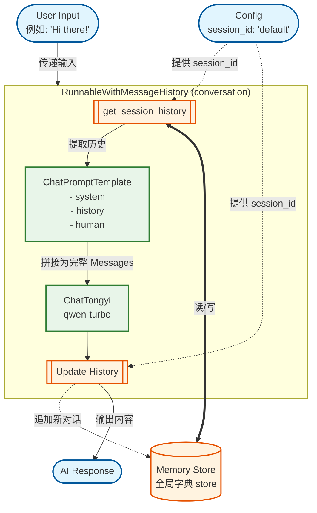
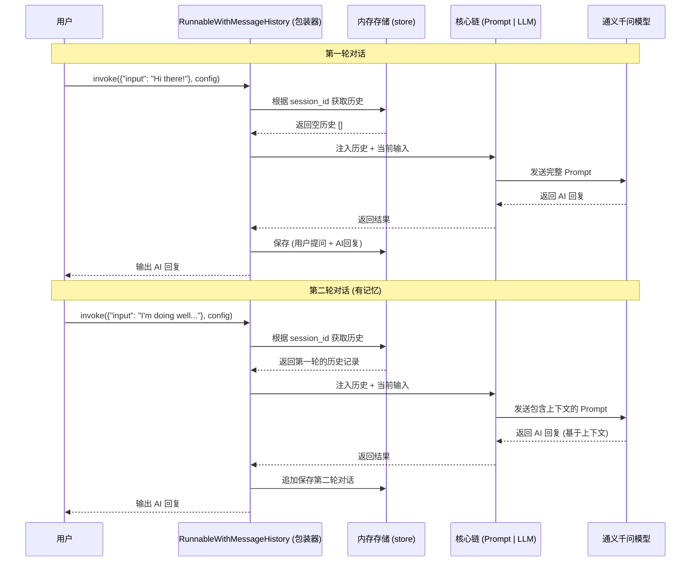

## 具备多轮记忆能力的对话链路

+ 示例代码使用 LangChain 框架和阿里云通义千问（ChatTongyi）模型，构建了一个具备多轮记忆能力的对话链路（Pipeline）。
+ 核心逻辑是利用 LangChain 表达式语言（LCEL）将 Prompt 和 LLM 组装成基础 Chain，然后用 RunnableWithMessageHistory 将其包装，实现根据 session_id 自动从内存字典（store）中读取和更新历史对话记录。

### 系统架构流图

+ 用 **Mermaid 流程图（Flowchart）** 来表达这种数据流和架构是非常合适的。由于这段代码的重点在于“组件的组装”和“数据的流转”，比起时序图，**系统架构流图**能更直观地展现 LangChain 的工作原理。

### 为什么这种表达方式最适合？

1. **解耦了核心链与记忆管理**：图中清晰地展示了基础的 `Prompt | LLM`（绿色部分）是被包裹在 `RunnableWithMessageHistory`（外层框）中的。这正是代码中 `chain = prompt | llm` 的直观体现。
2. **状态的可视化**：将 `store` 画成数据库/圆柱体图标，体现了它是独立于单次调用的全局状态。`config` 传入 `session_id` 作为钥匙去 `store` 里取数据的过程一目了然。
3. **LCEL 数据流向**：体现了 LangChain 中 `Input -> Prompt -> LLM -> Output` 这种经典的单向数据流。

### 时序图

