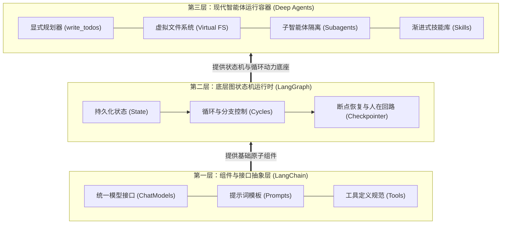
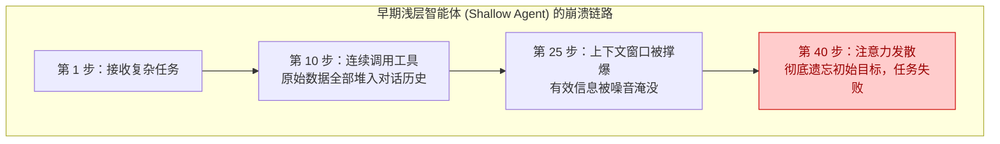
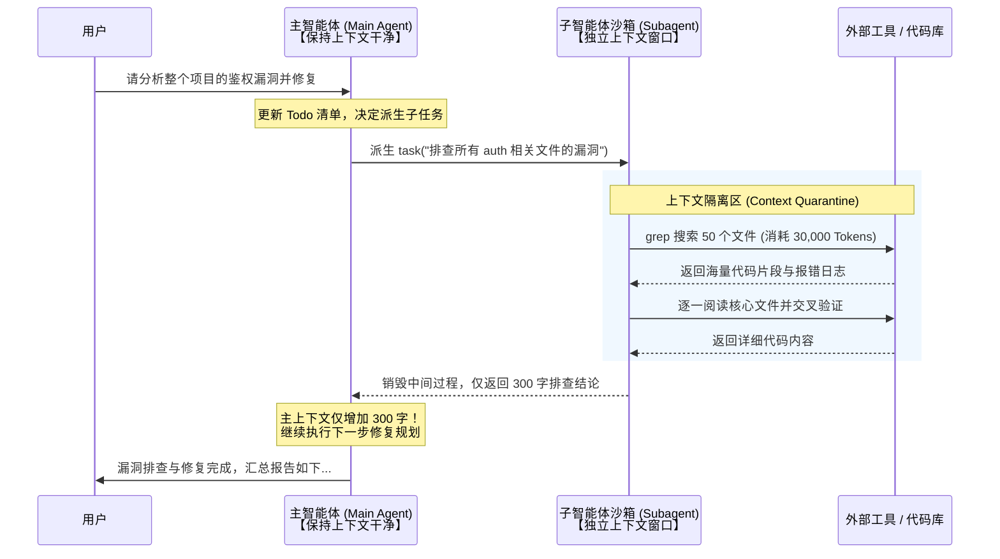
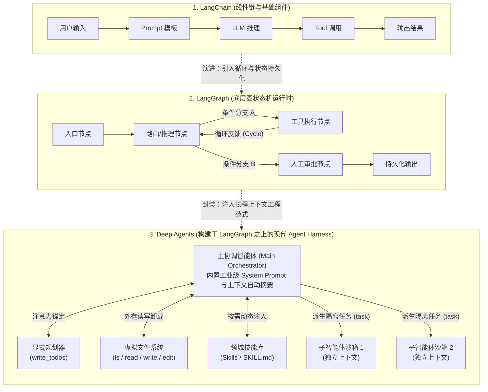

在探讨 AI Agent（智能体）开发框架时，我们经常会听到这样一种总结：

> “LangChain、LangGraph 和 Deep Agents 同属一家公司。其中，**LangChain** 是最早期的链式任务编排框架；**LangGraph** 在其基础上拓展成了网状或图状的编排框架；而 **Deep Agents** 则是更现代的通用智能体，核心在于它采用了 **Agent + Skill（技能）** 的模式。”

这段话前半部分对演进脉络的描述非常直观，但后半句却很容易引发一个深层的技术疑问：

**“现代 Agent”与“非现代 Agent”的分水岭，真的只是能不能使用 Skill 吗？**

如果仅仅是挂载一个 Skill，LangChain 和 LangGraph 难道就做不到吗？在工程实现上，给大模型动态塞一段操作指南（Skill）并不是什么高不可攀的黑科技，它显然不足以成为一个“划时代”的架构标准。

那么，究竟是什么底层机制，真正划开了早期智能体（Shallow Agents）与现代深层智能体（Deep Agents）的时代鸿沟？

## 一、 厘清三者关系：不是“祖孙三代替代”，而是“三层调用栈”

很多初学者容易把 LangChain、LangGraph 和 Deep Agents 误解为“互相淘汰的三代同类产品”。实际上，它们根本不在同一个抽象层级上，而是**自下而上的三层技术栈关系**。

我们可以通过下面这张架构分层图来理解它们各自的生态位：

为了更清晰地对比，我们可以用一个造车的架构比喻来总结：

| 框架名称 | 核心生态位 | 解决的核心痛点 | 工业界比喻 |
| :--- | :--- | :--- | :--- |
| **LangChain** | **组件与接口抽象层** | 抹平不同大模型（OpenAI、Claude 等）的 API 差异，提供基础组件与单向线性串联（Chains）。 | **标准零件库** （螺丝、齿轮、标准化发动机接口） |
| **LangGraph** | **底层图状态机运行时（Runtime）** | 引入“循环（Cycles）”、“全局状态持久化”和“人在回路”，让工作流可以回退、重试、循环推理。 | **可编程发动机与底盘** （提供循环动力与状态控制底座） |
| **Deep Agents** | **开箱即用的智能体容器（Agent Harness）** | **构建在 LangGraph 之上**，把 Claude Code、Manus 等现代产品的架构最佳实践固化为标准运行环境。 | **带自动驾驶系统的整车** （直接拿来跑长程复杂任务） |

简言之：**Deep Agents 底层依然是用 LangGraph 驱动的，而节点里的模型调用和工具封装依然依赖 LangChain 的基础抽象。** 它们是层层递进的封装，而非彼此推翻。

## 二、 破除迷思：为什么“用不用 Skill”不是核心壁垒？

要回答为什么“Skill”不足以成为划时代的标准，我们先要看清 Agent 语境下的 **Tool（工具）** 和 **Skill（技能）** 到底有什么区别。

* **Tool（工具）**：本质上是一个冷冰冰的**函数接口**（例如 `execute_sql()` 或 `read_file()`）。模型只知道函数的参数签名，但在面对复杂业务时，它往往不知道“先调哪个、后调哪个、遇到报错该如何降级处理”。
* **Skill（技能）**：是对 Tool 与领域知识的工程化封装。它是一套**按需动态加载的“领域 SOP 手册（通常是一个 `SKILL.md`）+ 专属脚本工具集 + 少量示例（Few-shot）”**。只有当 Agent 识别到特定意图时，才将这套 SOP 渐进式披露（Progressive Disclosure）到上下文中，避免一开始就把几万字的说明书塞爆上下文窗口。

### LangChain 和 LangGraph 不能用 Skill 吗？
**完全能用，而且实现起来一点都不难。**

在纯 LangGraph 甚至早期的 LangChain 中，你只需要写一个几行代码的路由节点或读取工具：当模型判定需要处理某类任务时，动态去磁盘读取一段 Markdown 格式的指令文本，追加到当前的 `SystemMessage` 或状态列表中，就手搓出了一套一模一样的 Skill 机制。

Deep Agents 所做的，只是把这套“按需读取 `SKILL.md`”的机制标准化、内置化了。因此，**把“拥有 Skill”当成现代 Agent 的核心标志，其实是把一个表层的应用规范，误当成了底层的架构革命。**

## 三、 真正的划时代分水岭：面向长程任务的“上下文工程”

既然 Skill 只是表象，那么真正让 LangChain / 基础 LangGraph 停留在“早期/基础设施”阶段，而让 Deep Agents 跨入“现代智能体”行列的**划时代标准**究竟是什么？

答案是：**面向长程复杂任务（Long-Horizon Tasks）的“上下文工程（Context Engineering）与自治容器架构（Agent Harness）”**。

### 早期 Agent（Shallow Agents）为什么会崩溃？
早期的 Agent 本质上是“一个 LLM 在循环里不断调 Tool（即基础 ReAct 循环）”。这种架构在执行 3～5 步的简单任务（比如查个天气再发封邮件）时表现得很惊艳；但一旦面对需要连续执行 50 步以上的长程任务（比如重构一个大型代码库、撰写一份深度行业研报），就会遭遇三大致命瓶颈：

1. **上下文爆炸（Context Bloat）**：读取了十几个文件、跑了几次搜索后，海量的原始返回结果和报错日志迅速塞满上下文窗口。
2. **注意力溃散（Attention Drift）**：在几万 Token 的历史垃圾信息干扰下，大模型开始顾此失彼，推理质量断崖式下降。
3. **目标迷失（Lost in the Middle）**：执行到第 30 步时，模型已经彻底忘了第 1 步设定的全局规划。

为了彻底解决长程任务的崩溃问题，Deep Agents 吸收了以 Claude Code 和 Manus 为代表的现代 Agent 架构精髓，引入了**四大核心支柱**。这四大机制，才是真正的“划时代标准”：

---

### 支柱 1：任务隔离机制——动态派生子智能体（Subagents & Context Quarantine）

在非现代 Agent 架构中，主 Agent 既当爹又当妈，自己去读 20 个文件、跑 10 次搜索，中间产生的所有过程噪音全部污染在主对话历史里。

而在现代 Deep Agents 中，主 Agent 扮演的是**“总架构师/调度员”**。当遇到繁琐的脏活累活（比如在几百个代码文件中排查某个函数的调用链）时，主 Agent 会通过内置的 `task` 工具，动态派生出一个生命周期极短的**子智能体（Subagent）**。

子智能体在自己独立的内存沙箱里消耗掉几万 Token 完成排查后，直接销毁自身与中间过程，**只把最终提炼出的几百字精准结论返回给主 Agent**。这种**“上下文隔离防火墙（Context Quarantine）”**机制，让主 Agent 的大脑永远保持清爽与清醒。

---

### 支柱 2：外存卸载机制——内置虚拟文件系统（Virtual File System）

早期 Agent 把所有的中间产物、长文本全都放在对话消息列表（`Messages State`）里传来传去。

现代 Deep Agents 则引入了计算机体系结构的思想：**把大模型的上下文窗口当成极其宝贵的 CPU 一级缓存（L1 Cache），同时为 Agent 挂载一套内置的虚拟文件系统（配备 `ls`、`read_file`、`write_file`、`edit_file`、`grep` 等标准工具）作为“内存与硬盘”。**

* **大结果自动卸载**：当某个工具返回了超长文本时，系统不再将其直接塞进对话流，而是转存到虚拟文件系统中，只给模型返回一个文件路径和简短摘要，让模型按需用 `read_file` 或 `grep` 分页查看。
* **多智能体协同黑板**：主智能体与子智能体之间不需要通过冗长的对话传递数据，直接读写虚拟文件系统中的同一份文件即可完成状态共享。
* **上下文自动压缩**：当历史消息逼近阈值时，中间件会自动将早期对话归档写入文件，并用高密度摘要替换原对话流。

---

### 支柱 3：注意力锚定机制——显式状态规划工具（`write_todos`）

早期 Agent 只靠提示词里的“Let's think step by step（一步步思考）”来做规划，没有持久化的任务账本，跑上几十步必然偏离航道。

Deep Agents 内置了一个强制性的 `write_todos` 规划工具。非常有趣的是，LangChain 官方团队曾坦承：**这个工具在底层代码实现上几乎是个“空操作（No-op）”**——它不调用任何外部 API，仅仅是在状态机里更新一张结构化的待办清单（包含 `pending`、`in_progress`、`completed` 状态）。

但这恰恰是一种极其高明的**上下文工程策略**：通过强制模型在每个关键节点调用该工具来重写或勾选任务清单，系统不断地将“全局目标与当前进度”刷新到上下文窗口的最末端（即模型注意力最集中的位置），从而在长达上百步的循环中牢牢锁住模型的注意力锚点。

---

### 支柱 4：编排范式的转移——从“手写控制流”到“自主环境容器（Agent Harness）”

这是开发体验上最本质的跨越：

* **传统 LangChain / LangGraph 开发（手写控制流）**：程序员像画流程图一样，在代码里硬编码：“节点 A 调搜索 -> 走条件边判断 -> 若失败走节点 B 重试 -> 若成功走节点 C 总结”。**控制流是由人类程序员预先写死的。**
* **现代 Deep Agents 开发（Agent Harness 容器）**：框架直接提供一个像操作系统一样的“重型容器”——里面已经预置了经过严密调优的工业级长系统提示词、虚拟文件系统、子智能体派生器、规划账本以及按需加载的 Skills 规范。程序员不再去硬编码“第几步走哪个分支”，而是规定好工具边界、挂载好领域 Skill，让大模型在容器内自主规划、自己读写文件、动态派发子任务。

## 四、 三代架构全景演进对比与选型指南

我们将这三者的拓扑结构放在一起，就能一目了然地看清从“链”到“图”，再到“现代深层智能体容器”的进化全貌：

### 实战选型建议：我们该如何选择？

理解了三者的定位后，在实际工程项目中，我们就不必盲目追新，而是根据业务场景精准选型：

1. **什么时候直接用 LangChain？**
   当你只需要快速实现一个简单的单步对话、基础的文档问答（RAG），或者只需要复用它现成的 Model/Tool 封装接口时，LangChain 依然是最轻量、最便捷的零件库。
2. **什么时候退回到底层手写 LangGraph？**
   当你的业务流程具有**极强的确定性要求和严密的合规边界**时（例如银行信贷审批流、固定SOP的客服退换货流程）。这类场景下，你绝对不希望大模型自由发挥，而是需要由程序员用图节点（Nodes）和条件边（Edges）把每一步状态流转死死锁住。
3. **什么时候直接上现代的 Deep Agents？**
   当你要构建的是**开放式、长链路、高自治度的复杂智能体**时（例如：自主编写并调试代码的 AI 程序员、自动搜集全网资料生成万字报告的 Deep Research 助手、复杂数据分析 Agent）。直接采用 Deep Agents 的容器架构，能帮你省去从零手搓虚拟文件系统、上下文裁剪、Todo 账本和子代理隔离沙箱的巨大工程量。

## 五、 结语

回到我们最初的问题：**现代 Agent 与早期 Agent 的划时代分水岭到底是什么？**

绝不是表象上的“能不能用 Skill”，而是**底层架构从“工具连接器”向“长程上下文工程容器（Agent Harness）”的范式跃迁**。

> 早期的框架（LangChain / 基础编排）致力于帮我们**“把大模型和外部工具连起来”**；而现代的深层智能体架构（Deep Agents）则是在构建一套类似操作系统的运行时环境——它通过**虚拟文件系统**做外存卸载、通过**动态子智能体**做上下文隔离、通过**显式 Todo 账本**做注意力锚定、通过 **Skill 规范**做领域知识的渐进式披露。

正是这四大支柱的协同运转，才让 AI Agent 真正跨越了“玩具级 Demo”的局限，具备了连续自主执行几十上百步复杂任务而不崩溃的现代工程能力。
