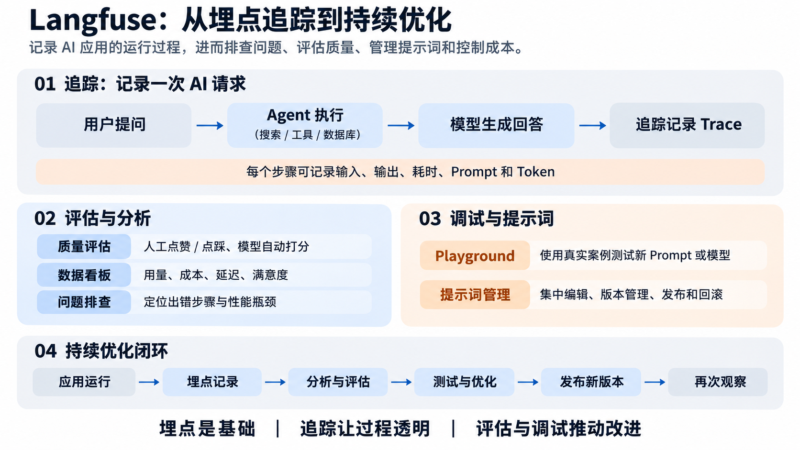
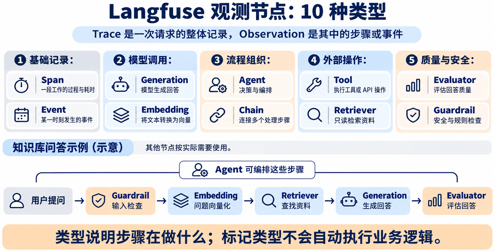

开发大模型应用时，回答出错只是表象：问题可能出在提示词、知识检索、工具调用，也可能来自模型本身。Langfuse 的作用，是帮助我们看清应用内部发生了什么，并以数据为依据持续改进。

## 一、Langfuse 能做什么



### 1. 从“埋点”理解可观测性

如果把大模型应用比作一辆自动驾驶汽车，Langfuse 就像它的**行车记录仪和数据分析中心**。开发者在代码中接入 SDK 或框架集成，让应用在运行时上报重要步骤，Langfuse 再把这些记录组织起来，供排查和分析使用。

这类记录通常称为**追踪（Tracing）**，它是可观测性（Observability）的重要组成部分。埋点是采集信息的手段，最终目的是定位问题、评估效果和优化应用。

### 2. 追踪复杂执行过程

假设用户问：“根据公司知识库，解释产品的退款政策。”一个 AI Agent 可能依次完成意图识别、知识库检索、整理上下文和模型生成。最终答案不准确时，追踪记录可以帮助我们检查：

- **输入和输出**：用户问了什么，每一步返回了什么。
- **执行过程**：调用了哪些步骤，它们之间是什么关系。
- **提示词**：模型实际收到的输入和上下文是什么。
- **耗时**：哪些步骤慢，瓶颈出在哪里。
- **用量和成本**：模型消耗了多少 Token，估算成本是多少。

能否看到完整内容取决于接入方式、上报的数据和配置。例如，成本计算依赖可用的用量和模型价格信息；人民币金额也可能需要自行换算。

### 3. 回答质量评估

记录回答之后，还需要判断回答是否有用。Langfuse 支持将评估结果与追踪记录关联，常见方式包括：

- **人工反馈**：例如收集用户的赞、踩，或由人工审核回答。
- **自动评估**：使用规则、代码或 LLM-as-a-Judge，检查答案的相关性、准确性或格式等。

例如，对“退款政策”的回答，可以同时检查是否引用正确条款、是否遗漏时限。自动评分依赖评估标准和评估器本身的质量，不能简单等同于事实真相。

### 4. 提示词集中管理

如果提示词写死在代码中，调整内容通常需要修改代码并重新部署。Langfuse 的 Prompt Management 可以集中管理提示词、维护版本和标签；应用通过 SDK 获取相应提示词后使用。

例如，团队可以发布新版客服提示词，再通过版本或标签切回旧版本。是否能在不部署代码的情况下生效，取决于应用如何获取提示词、缓存和选择版本。

### 5. 成本与数据看板

当追踪数据积累起来，就可以从单条请求扩展到整体分析，例如：

- 每天、每月的模型用量和估算成本。
- 哪些功能、模型或用户的消耗较高。
- 延迟变化，以及质量评分或用户反馈的趋势。

这些指标依赖相关字段和评分被正确采集、关联，不能假设系统会凭空获得全部数据。

### 6. 调试与回放

发现一条回答不佳的真实记录后，可以把相关输入用于 Playground 测试：修改提示词、调整参数或尝试其他已配置的模型，再比较结果。模型服务、权限以及记录中可用的数据会影响实际操作；重新运行也不保证完全复现原结果。

### 7. 各项能力如何配合

一个典型的持续优化过程是：

1. **记录**：应用运行时生成追踪数据。
2. **分析**：查看执行链路、延迟、成本和质量反馈，找到问题。
3. **改进**：在 Playground 中试验，在提示词管理中维护和发布改进版本。
4. **验证**：观察新版本的追踪与评估结果，继续调整。

提示词管理本身也可以独立使用；追踪、评估与测试则帮助团队判断改动是否真正有效。

## 二、Langfuse 观测节点类型详解



### 1. 先分清 Trace 和 Observation

**Trace（追踪）**可以理解为一次请求或一次工作流的完整记录。**Observation（观测节点）**是记录中的一个具体步骤或事件；节点可以有父子关系，形成执行树。

例如，一次知识库问答可以包含一个 Agent 节点，以及它下面的检索、模型生成等节点。Trace 是组织这些记录的整体，**不是下面列出的十种 Observation 类型之一**。节点的父子关系表示工作如何被组织，不必然意味着所有子节点严格串行执行。

### 2. 十种类型一览

| 类型 | 主要用途 | 示例 |
| --- | --- | --- |
| `span` | 记录有开始和结束的通用工作 | 清洗用户输入 |
| `event` | 记录某一时刻发生的离散事件 | 命中缓存 |
| `generation` | 记录模型生成调用 | 根据上下文生成回答 |
| `agent` | 记录负责决策和编排的 Agent 工作 | 决定是否调用工具 |
| `tool` | 记录一次工具、函数或 API 操作 | 调用天气接口 |
| `chain` | 记录连接多个应用步骤的流程 | 把检索结果整理后交给模型 |
| `retriever` | 记录只读的数据检索 | 从向量数据库查询文档 |
| `embedding` | 记录生成向量表示的模型调用 | 将问题转换为向量 |
| `evaluator` | 记录评估过程 | 检查答案是否与资料一致 |
| `guardrail` | 记录安全或规则防护检查 | 检查输入是否违规 |

这十种类型提供语义标签，帮助人们理解和筛选步骤。**选择类型不会自动实现该步骤的业务逻辑**：例如将节点标为 `guardrail` 并不会自动拦截风险内容，仍需应用执行检查并记录结果。

### 3. 通用记录：Span 与 Event

**Span** 适合记录一段持续的工作，比如处理输入、转换数据或调用一个没有更合适类型的函数。它通常有开始时间和结束时间，可以查看耗时、输入、输出和错误信息。

**Event** 适合记录一个离散的时间点，例如“缓存命中”或“用户取消请求”。如果你需要衡量一段操作花了多久，通常应使用 Span 或其他有持续时间的节点。

### 4. 模型调用：Generation 与 Embedding

**Generation** 用于大模型生成，例如意图识别、生成摘要或最终回答。重点关注模型、输入消息、输出、参数、Token 用量和成本。具体字段能否展示取决于是否上报和配置。

**Embedding** 用于把文本等内容转换为向量，例如将用户问题向量化，以便进行语义检索。它和 Generation 都涉及模型调用，但目的不同：前者得到向量，后者通常得到文本或其他生成结果。

### 5. 流程组织：Agent 与 Chain

**Agent** 侧重决策和编排：它可以依据任务决定是否调用工具、调用什么工具，以及下一步做什么。

**Chain** 侧重把多个步骤连接起来，例如将检索结果格式化后交给模型。一个应用可以同时有 Agent 和 Chain，也可以只有其中一种；不必为了使用这些类型而人为增加一层流程。

### 6. 外部操作：Tool 与 Retriever

**Tool** 表示一次具体操作，如调用天气接口、执行计算，或调用业务系统 API。工具可能只读，也可能产生副作用。

**Retriever** 强调只读检索，如查询向量库、数据库或知识库。虽然检索也可以通过工具实现，但将其标为 `retriever` 能更清楚地表达“这是查找资料的步骤”。

### 7. 质量与安全：Evaluator 与 Guardrail

**Evaluator** 用来记录评估过程，例如检查回答是否切题、是否与参考资料一致。评估可以在回答生成后进行，也可能发生在其他环节。记录一个 `evaluator` 节点和把评分作为 Score 写入 Langfuse 是不同操作；需要关联评分时，还应按评分接口完成上报。

**Guardrail** 记录防护检查，例如检查输入是否违反规则，或者检查输出是否包含敏感信息。真正的拦截或放行由应用或防护组件执行，节点用于记录检查过程和结果。

### 8. 用一个知识库问答串起来

用户问：“公司的退款期限是多久？”一次可能的执行过程如下：

```text
Trace：处理一次退款政策咨询
└── agent：决定如何回答
    ├── guardrail：检查输入是否符合规则
    ├── embedding：将用户问题转换为向量
    ├── retriever：检索相关退款条款
    ├── chain：整理检索结果和提示词
    ├── generation：生成最终回答
    └── evaluator：检查回答与检索资料是否一致
```

如果这次调用了外部业务接口，可以增加 `tool` 节点；如果想记录“缓存命中”，可以增加 `event`；一般性预处理则可以使用 `span`。实际项目不必包含所有类型，应该根据真正发生的操作选择。

### 9. Python 中如何指定类型

以下示例展示两种常见写法。根据 Langfuse 官方文档，使用这些类型需要 Python SDK 3.3.1 或以上版本，并需要事先完成 Langfuse 客户端配置。函数中的业务逻辑只是示意。

**方式一：使用 `@observe` 装饰函数**

```python
from langfuse import observe

@observe(as_type="retriever", name="search-knowledge-base")
def search_knowledge_base(query: str):
    # 实际项目中替换为向量数据库或知识库查询
    return ["退款申请应在规定期限内提交。"]

@observe(as_type="agent", name="answer-question")
def answer_question(query: str):
    documents = search_knowledge_base(query)
    return {"query": query, "documents": documents}

answer_question("退款期限是多久？")
```

外层被装饰函数调用内层被装饰函数时，SDK 可根据当前上下文建立父子关系。具体记录哪些输入、输出还受 SDK 配置及数据采集策略影响。

**方式二：使用上下文管理器手动创建节点**

```python
from langfuse import get_client

langfuse = get_client()

def normalize_query(query: str) -> str:
    with langfuse.start_as_current_observation(
        as_type="span",
        name="normalize-query",
        input={"query": query},
    ) as observation:
        normalized = query.strip()
        observation.update(output={"query": normalized})
        return normalized
```

上下文管理器会在代码块结束时关闭节点。对于手动创建、需要自己管理生命周期的节点，应确保成功或异常时都正确结束；短生命周期脚本在退出前还应根据 SDK 使用方式调用 `langfuse.flush()`，等待待发送数据提交。

### 10. 实际埋点时的几个原则

1. **先覆盖关键路径**：从请求入口、检索、模型调用和关键工具开始，再按排障需要增加细节。
2. **名称表达业务含义**：例如 `search-knowledge-base` 比 `step-2` 更容易理解。
3. **类型与实际行为一致**：只读检索用 `retriever`，模型生成用 `generation`，无法明确分类时用 `span`。
4. **留意敏感信息**：输入、输出和上下文可能包含个人信息或密钥，应按业务要求脱敏、控制采集范围和访问权限。
5. **检查数据是否真的到达**：在 Langfuse 界面核对节点层级、输入输出、错误、用量和耗时，而不是仅凭代码中有埋点就认为记录完整。

## 参考资料

- [Langfuse：Observation Types](https://langfuse.com/docs/observability/features/observation-types)
- [Langfuse：Observability](https://langfuse.com/docs/observability/overview)
- [Langfuse：Prompt Management](https://langfuse.com/docs/prompt-management/overview)
- [Langfuse：Evaluation](https://langfuse.com/docs/evaluation/overview)
