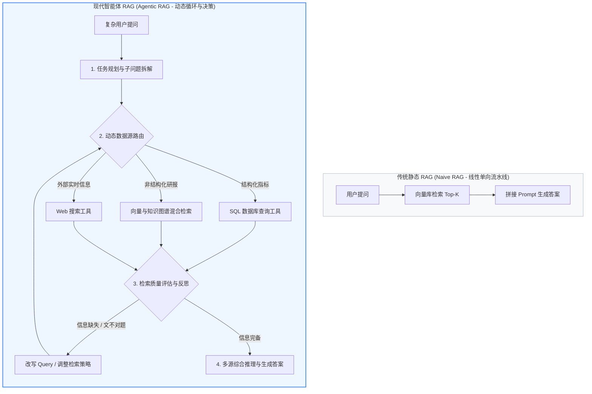
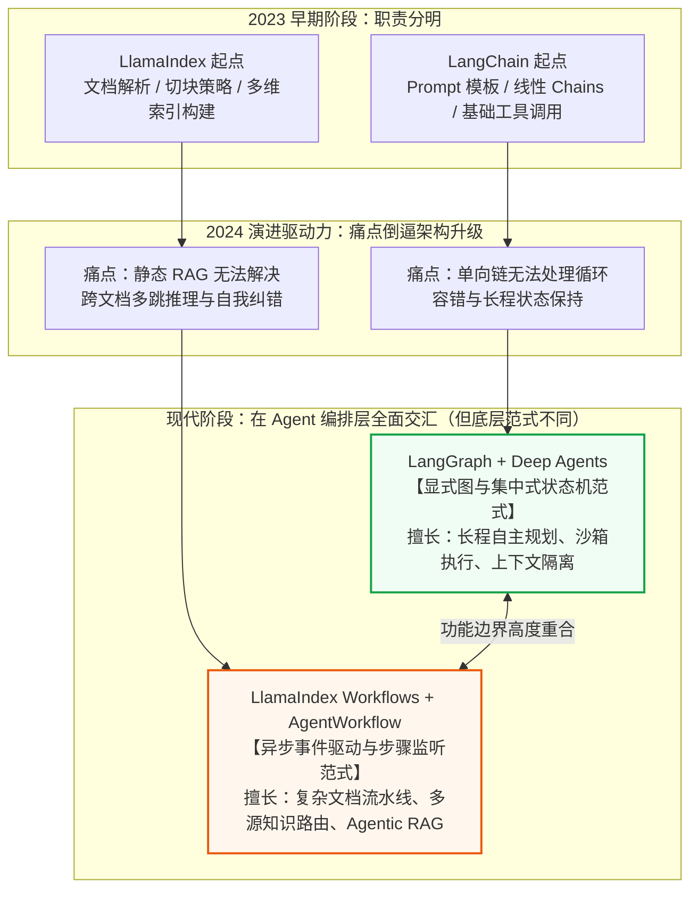
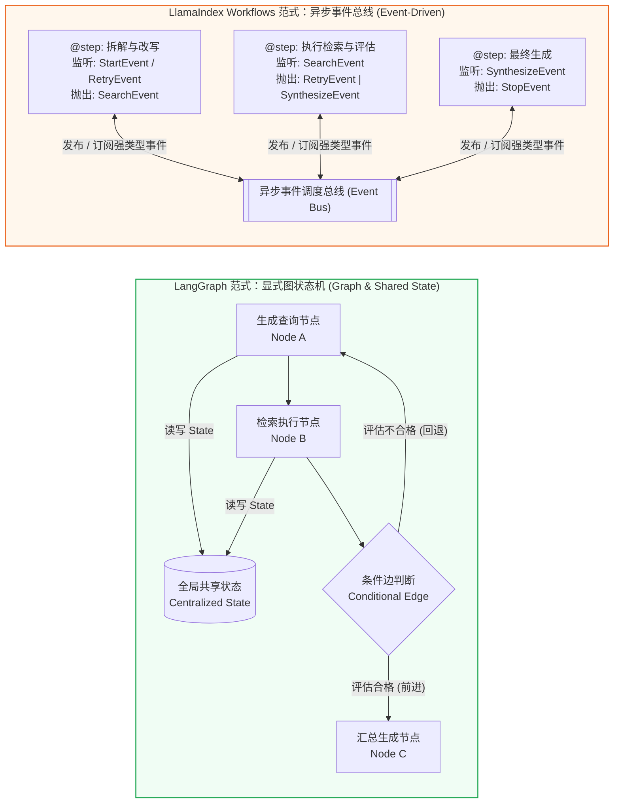

在大模型应用开发的早期阶段，技术社区有一句广为流传的选型口诀：**“做知识库检索（RAG）用 LlamaIndex，做智能体编排（Agent）用 LangChain。”**

但如果你最近翻看 LlamaIndex 的官方文档和最新版本架构，会产生一种强烈的既视感：它不仅有自己的 `FunctionAgent`、`ReActAgent`，还推出了支持复杂循环编排的 `Workflows` 以及支持多智能体协作的 `AgentWorkflow`。很多人因此疑惑：**为什么一个专攻 RAG 的数据框架，越长越像 LangChain 了？**

要理解这一现象，我们需要看清大模型工程领域过去两年最重要的一个演进趋势：**静态 RAG 的消亡，以及两大头部框架在“Agent 编排层”的必然交汇。**

## 一、 历史出身：曾经泾渭分明的“楚河汉界”

在 2023 年大模型应用爆发初期，LlamaIndex 和 LangChain 的基因截然不同，分别守住了大模型应用落地的两个核心命门：

* **LlamaIndex（原名 GPT Index）：数据中心派（Data-Centric）**
它的初衷非常纯粹——解决“如何把企业私有的外部数据（PDF、Word、SQL、API）高效、精准地喂给大模型”。因此，它在文档解析（LlamaParse）、文本切块（Chunking）、多级索引构建（向量索引、树状索引、知识图谱索引）以及混合检索重排（Rerank）上构筑了极深的技术壁垒。
* **LangChain：流程与动作派（Action-Centric）**
它的初衷是做通用胶水与编排层——把提示词模板、不同厂商的大模型、外部工具（搜索、计算器、代码解释器）串联起来，让大模型不仅能回答问题，还能调用接口执行外部动作。

在那个阶段，两者的界限极其清晰。标准的企业级架构往往是“组合拳”：用 LlamaIndex 处理复杂的文档切分并构建高精度检索器（Retriever），然后将这个检索器封装成一个标准的 `Tool`，交给 LangChain 的 Agent 去调度执行。

## 二、 核心转折：为什么做着做着 RAG，就必须造自己的 Agent？

既然分工如此明确，为什么 LlamaIndex 不安分守己只做数据检索底座，反而亲自下场造出了一整套 Agent 框架？

根本原因在于：**传统的静态 RAG（Naive RAG）遇到了严重的天花板，而高级 RAG 在本质上就是一个 Agent。**

### 1. 静态流水线搞不定真实的业务问题

早期的 RAG 是一条死板的单向流水线（DAG）：
`用户提问 -> 向量相似度检索 Top-K 段落 -> 塞进 Prompt -> 大模型生成答案`。

这套流程在回答“公司年假制度是什么”这类单点事实时表现尚可，但一旦遇到复杂的跨度问题，就会彻底失效。例如用户提问：

> *“请对比我们公司 2024 年 Q1 和 2025 年 Q3 在华东区的毛利率变化，并结合当时的行业研报分析背后的核心原因。”*

面对这个问题，静态 RAG 直接束手无策——因为没有任何一个单一的文档切片（Chunk）同时包含这两个时间跨度的财务数据和市场研报。

### 2. 当检索引入“路由、拆解与反思”，它就变成了 Agent

为了让 RAG 能够回答上述复杂问题，工程师们被迫往检索流程里一步步引入动态决策机制：

1. **意图路由（Routing）**：先判断这个问题应该去查结构化的 SQL 财务数据库，还是去查非结构化的 PDF 行业研报？
2. **查询拆解（Sub-Question Decomposition）**：把一个复杂大问题拆解成 3 个独立的子查询，分别去不同数据源检索后再汇总。
3. **自我反思与纠错（Self-Reflection / Corrective RAG）**：检索出来的内容如果发现文不对题怎么办？必须让大模型评估检索质量，自动改写搜索词（Query Rewrite），**退回去重新检索一次**。

我们可以用下面这张对比图直观感受从“静态 RAG”到“Agentic RAG”的质变：

仔细观察下半部分的 `Agentic RAG` 架构：一旦在检索流程中引入了“自主规划拆解 + 多工具路由 + 循环重试 + 状态保持”，这套系统在计算机科学定义上就已经不再是一个简单的“检索器”，而是一个地地道道的 **Agent（智能体）**。

LlamaIndex 团队敏锐地意识到：既然高级 RAG 的尽头必然是 Agent，与其让开发者为了写一个循环纠错逻辑而跳出 LlamaIndex 去引入 LangChain/LangGraph，不如直接在自家框架内部提供原生的 Agent 与工作流编排引擎，打通从“底层数据解析”到“上层智能体决策”的完整闭环。

## 三、 殊途同归背后的差异：图状态机 vs. 事件驱动

正因为“LangChain 向下补齐了部分数据接入能力，LlamaIndex 向上长出了完整的 Agent 编排层”，两大框架在功能版图上实现了全面交汇。

虽然现在两者都能用来写多步循环 Agent 和多智能体系统，但如果你深入到代码工程层面，会发现两家公司在打造现代 Agent 运行时（Runtime）时，选择了**截然不同的底层编程范式**：

### 1. LangGraph：显式图与集中式状态机（Graph & Centralized State）

LangChain 演进出的 `LangGraph`（以及构建在其上的 `Deep Agents`）采用的是**图状态机模型**。

* **核心心智**：系统中存在一个全局共享的 `State`（状态字典）。开发者需要先声明一个个节点函数（`Node`），再用实线边（`Edge`）或条件边（`Conditional Edge`）把节点连成一张网。
* **数据流转**：每个节点读取全局 `State`，处理完后返回增量更新写回 `State`，再由条件边决定下一步跳往哪个节点。

### 2. LlamaIndex Workflows：异步事件驱动架构（Event-Driven Architecture）

为了避免直接照搬 LangGraph 的画图模式，LlamaIndex 在重构其现代编排层时，选择了后端微服务中常见的**事件驱动模型（Event-Driven）**。

* **核心心智**：不需要预先去连一张复杂的图（不用写 `add_node` 和 `add_conditional_edges`）。开发者只需要定义不同的强类型事件类（如 `QueryEvent`、`RetrievalResultEvent`、`RetryEvent`），然后在处理函数上加一个 `@step` 装饰器。
* **数据流转**：通过 Python 的类型注解（Type Hints）声明某个 `@step` 函数“接收什么事件、返回什么事件”。运行时引擎会自动充当消息总线，一旦某个函数抛出了特定事件，所有订阅了该事件类型的下游函数就会被自动异步触发。

我们可以用下面这张架构图对比两种编程范式在实现同一个“带反思循环的 Agent”时的底层差异：

### 3. 两大现代框架核心维度全景对比

| 对比维度 | LangChain / LangGraph / Deep Agents 体系 | LlamaIndex (Workflows / AgentWorkflow) 体系 |
| --- | --- | --- |
| **底层设计哲学** | **集中式状态机 + 显式有向有环图** | **异步事件驱动（Event Bus）+ `@step` 装饰器订阅** |
| **代码编写体验** | 像在画严谨的状态流转图，流程拓扑一目了然，但节点多时连线代码略显繁琐。 | 像在写基于消息队列的异步微服务，靠 Python 类型注解自动路由，组件解耦极度干净。 |
| **长程任务与上下文工程** | **极强**。通过 `Deep Agents` 原生提供虚拟文件系统卸载、子代理沙箱隔离与显式 Todo 锚定。 | **中等偏强**。通过 `Context` 对象跨步骤共享状态，更侧重于知识检索链路中的上下文拼装与提纯。 |
| **非结构化数据处理** | **基础**。自带的 Document Loaders 仅满足常规需求，复杂文档需依赖第三方库。 | **行业顶尖**。拥有极其丰富的索引结构、切块器，以及专门攻克复杂嵌套表格/图表的 `LlamaParse`。 |
| **商业化变现落脚点** | 靠 **LangSmith**（全链路可观测性与评测平台）以及云端 Agent 沙箱运行时赚钱。 | 靠 **LlamaCloud / LlamaParse**（企业级高精度非结构化文档解析与托管 RAG 数据管道）赚钱。 |

## 四、 架构师选型指南：在实际项目中该如何抉择？

既然 LlamaIndex 也有了完备的 Agent 能力，而 LangGraph 也能接向量数据库做 RAG，在实际工程落地中，我们到底该如何做技术选型？

答案依然藏在它们各自的基因里：

### 1. 什么时候首选 LlamaIndex（含 Workflows）？

当你的核心业务场景属于“重度知识密集型 / 数据与文档驱动型（Data-Heavy）”时：

* 比如：企业级投研报告深度分析系统、跨海量复杂 PDF 合同的合规审查 Agent、需要同时横跨多个关系型数据库（Text-to-SQL）与非结构化知识库进行混合多跳推理的问答系统。
* 在这类场景下，最痛的往往不是 Agent 的控制流，而是“表格解析串行了、分块把上下文切碎了、多路召回精度不够”。直接用 LlamaIndex 的数据组件配合它原生的 `Workflows` 编写 Agentic RAG，技术栈最统一，开发体验最丝滑。

### 2. 什么时候首选 LangGraph / Deep Agents？

当你的核心业务场景属于“重度动作执行型 / 长程自主任务型（Action & Task-Heavy）”时：

* 比如：全自动写代码修 Bug 的研发助手、需要连续操作终端或浏览器的自动化运维 Agent、动辄几十步且需要严格断点恢复（Time-Travel）与人工审批（Human-in-the-loop）的复杂业务流系统。
* 在这类场景下，核心痛点是“长链路下的上下文爆炸、工具调用死循环、多子代理的环境隔离”。此时，LangGraph 严谨的状态快照底座与 `Deep Agents` 开箱即用的容器化上下文工程套件（虚拟文件系统、子代理隔离沙箱）有着绝对的统治力。

### 3. 强强联合的“现代混合架构”

在大型企业级项目中，两者不仅不冲突，反而经常以更现代的方式结合：**以 LangGraph / Deep Agents 作为顶层的“大脑与长程任务调度容器”，而将 LlamaIndex（特别是 LlamaParse + 混合检索管线）封装为底层高精度的“深度知识检索引擎（作为 Tool 或专门的检索 Subagent）”**。这样既享受了 LlamaIndex 在数据解析与检索上的极致精度，又拥有了 Deep Agents 在长程任务规划与上下文隔离上的强大控制力。
