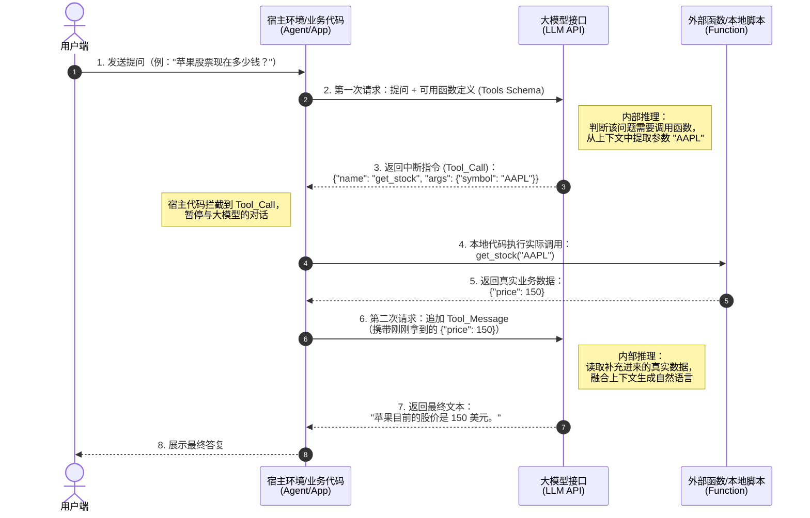
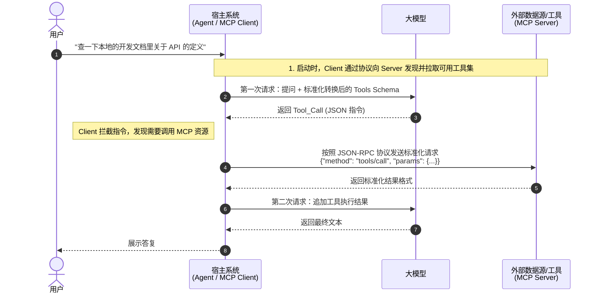
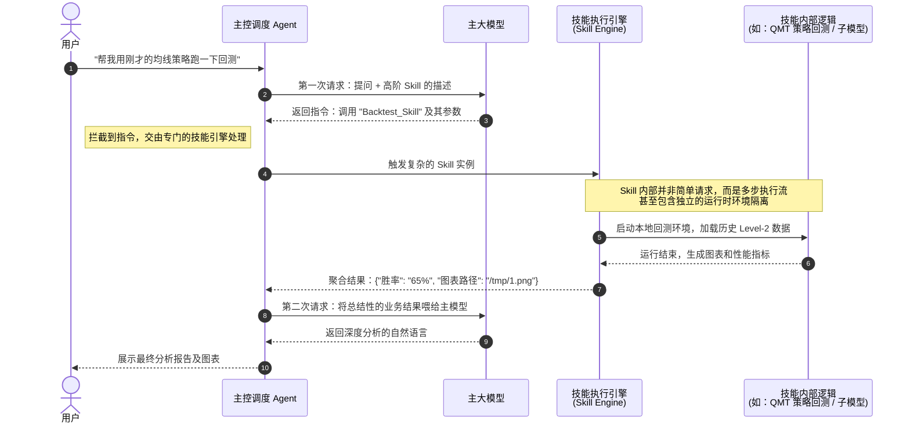

## 剥开大模型的“全能”外衣：Function Call、MCP 与 Skill 的底层架构演进

在当今的 AI 开发圈，让大模型“长出手脚”去操作外部系统已经成为标配。无论是简单的查天气，还是复杂的自动化代码生成，背后都离不开工具调用。但随着应用复杂度的提升，我们经常会听到 Function Call、MCP（Model Context Protocol）以及 Agent Skill 这几个概念混杂在一起。

在过去二十多年的软件研发与架构演进中，我们明白一个道理：**任何新技术的引入，本质上都是在寻找更优雅的解耦与抽象方式。** 大模型的工具调用也不例外。

本文将从系统架构的视角，带你彻底厘清这三者的底层逻辑、异同点以及适用场景。

## 一个核心错觉：大模型在“执行”代码

在深入对比之前，必须先纠正一个常见的直觉偏差：**大模型绝对不会自己去实际执行网络请求或运行本地代码。**

大模型是一个纯粹的文本推断引擎。无论是哪种调用机制，在 LLM 自身的视角里，它永远只做两件事：

1. **看说明书**（读取 Prompt 里的工具定义）。
2. **输出结构化指令**（吐出带有参数的 JSON 字符串）。

真正去查数据库、调用 FastAPI 接口或者运行本地脚本的，永远是包裹着大模型的**宿主运行环境（Host/Runtime）**。Function Call、MCP 和 Skill 的区别，并不在模型内部，而是**宿主环境的工程架构设计、系统解耦程度以及业务逻辑的厚度**。

## 1. 原语层：Function Call —— 大模型的基础“汇编指令”

Function Call 是 OpenAI 最先提出并被各大模型广泛支持的底层机制。在这一层，你的应用代码和工具函数往往是强耦合的。可以把它看作是单体架构下最直接的本地函数调用。

**运行机制：**
宿主应用把可用的函数（名称、描述、入参结构）喂给大模型；大模型如果认为需要调用，就中断文本生成，返回一段 JSON 格式的指令；宿主代码拦截到指令，在本地执行对应的 Python 函数后，把结果再次塞回给模型，完成闭环。

**定位：** 最底层的能力原语。适合轻量级的工具集成，缺点是工具的扩展和跨语言/跨机器调用不够标准化。

## 2. 协议层：MCP (Model Context Protocol) —— 工具接入的微服务化

当你的 AI 助手需要接入本地 IDE、知识库、外部数据库等几十种工具时，让宿主应用把这些工具的代码全写在一起显然违背了高内聚低耦合的原则。

MCP 应运而生。它是 Anthropic 等主导的**标准通信协议**。在 MCP 架构下，宿主变成了 **MCP Client**，而工具被抽离成了独立的 **MCP Server**。这就好比将单体应用拆分成了微服务，通过标准的 JSON-RPC 进行跨进程甚至跨机器的交互。

**定位：** 标准化协议层。解决了“工具发现”与“跨进程通信”的问题，让大模型能以极其统一的姿态连接各种异构数据源和执行环境。

## 3. 业务层：Skill (技能) —— 高内聚的复杂工作流与状态机

在实际的重度研发场景中，比如多 Agent 协作系统，我们极少让主控大模型去直接调用细粒度的基础 API（比如“连接数据库”、“执行 SQL”、“处理时间戳”）。这会导致主模型的 Prompt 极度臃肿，且非常容易发生“幻觉”和偏航。

这就引出了 **Skill（技能）** 的概念。Skill 是在工程架构上做的**业务级封装**。

例如，你需要构建一个量化交易的 Agent：你不会把具体的 Level-2 盘口数据解析 API 直接暴露给主模型，而是封装一个名为 `run_qmt_backtest_skill` 的高级技能。主模型只需要做高层的决策并发起调用，而 Skill 内部隐藏了一个完整的状态机逻辑，可能会自行调用 Python 脚本、驱动专用的底层框架执行回测、生成图表，最后只把核心结果摘要交还给主模型。

**定位：** 架构设计上的业务抽象层。用于任务拆解和系统隔离，保护主模型免受底层琐碎执行流的干扰。

---

## 总结：同源而殊途

最后，我们可以用一张表来总结这三者的异同点：

| 对比维度 | Function Call | MCP (Model Context Protocol) | Skill (技能) |
| --- | --- | --- | --- |
| **在大模型眼里的形态** | 一段工具描述 + 输出 JSON 指令 | 一段工具描述 + 输出 JSON 指令 | 一段工具描述 + 输出 JSON 指令 |
| **工程架构定位** | 底层能力原语 | 标准化通信协议 | 业务逻辑封装与抽象层 |
| **宿主侧的复杂度** | 低（单体调用，通常同语言、同进程） | 中（基于 JSON-RPC 的 C/S 架构，跨进程/机器） | 高（内部可能包含子 Agent、状态机或复杂脚本引擎） |
| **核心解决的问题** | 让大模型具备结构化输出能力 | 解决异构工具的标准化接入与发现 | 解决复杂任务拆解，防止大模型上下文污染 |
| **类比传统软件开发** | `def` 本地函数调用 | HTTP / RESTful API | 业务模块 / 黑盒微服务系统 |

从 Function Call 到 MCP 再到 Agent Skill，大模型本身的运作机制并没有发生本质的改变。真正进化的，是我们作为开发者，在面对日益复杂的 AI 应用需求时，所采用的**系统级解耦与抽象思维**。理解了这一点，就能在架构选型时有的放矢，游刃有余。
