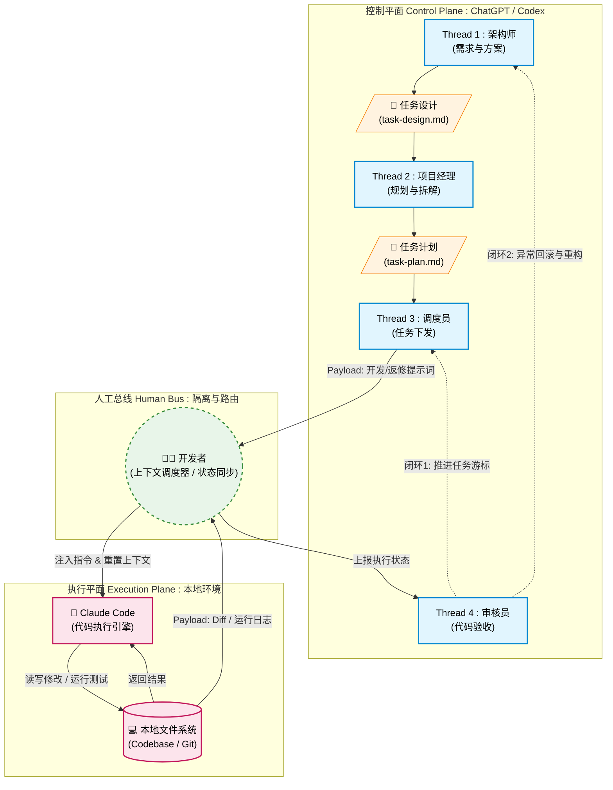
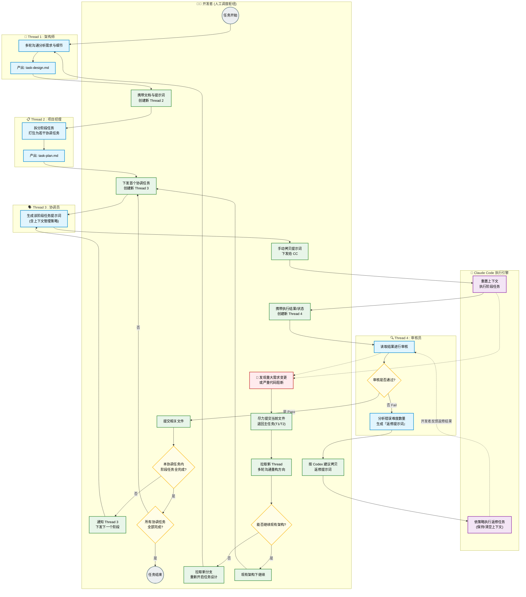

## 引言：为什么我们需要多 Agent 协作？

在使用大语言模型（LLM）进行日常软件开发时，很多开发者都会遇到一个痛点：**上下文污染与指令遗忘**。当我们试图在一个超长的对话窗口中完成“需求分析 -> 架构设计 -> 拆解任务 -> 编写代码 -> 持续 Debug”的全流程时，AI 往往会陷入混乱，忘记最初的设计约束，甚至在修复一个 Bug 时引入两个新 Bug。

为了解决这个问题，我摸索出了一套基于 **ChatGPT (Codex)** 和 **Claude Code** 的多线程（Multi-Thread）、多角色解耦开发工作流。在这套工作流中，AI 被赋予了架构师、项目经理、协调员和执行者等不同角色，而开发者则退居幕后，成为了掌控全局的“调度枢纽”。

本文将详细拆解这套工作流的运转逻辑。

## 整体架构：各司其职的角色设定

在这套体系中，我们将庞大的开发任务按生命周期进行了严格的切割。每个节点都有专门的 Agent（Thread）负责，绝不越权：

* **🧠 Thread 1 (架构师)**：负责需求确认、多轮沟通与技术决策。
* **📋 Thread 2 (项目经理)**：负责整体计划、任务拆解与协调任务的打包。
* **🗣️ Thread 3 (协调员)**：负责管辖范围内的子任务下发与上下文策略制定。
* **🔍 Thread 4 (审核员)**：负责 Code Review、结果验收与返修策略制定。
* **🤖 Claude Code (执行引擎)**：负责在本地环境物理执行代码编写与修改。
* **👨‍💻 开发者 (人工总线)**：不直接写代码，而是作为状态同步器，负责在各个孤立的 AI Thread 之间搬运提示词、同步执行状态。

### 架构说明图

### 带泳道的跨职能流程图

## 核心流程拆解：四个阶段的完美闭环

### 第一阶段：任务范围确认 (Thread 1)

一切始于需求的对齐。开发者首先与 Thread 1 开启多轮对话，深入分析需求细节，权衡并选择最合适的技术解决方案。

* **核心产出**：经过充分沟通后，Thread 1 会将最终的解决方案沉淀为一份《任务设计文档》（如 `task-design.md`）。
* **流转动作**：Thread 1 会自动生成用于开启下一阶段的提示词，并创建全新的 Thread 2。提示词中指定要先阅读这份任务设计文档。

### 第二阶段：任务规划与调度 (Thread 2)

在拿到 `task-design.md` 后，Thread 2 开始行使“项目经理”的职能，进行任务拆解与排期。

* **任务分界**：它会将总任务拆分为若干个“阶段任务”（例如 8 个），并设立高一级的“协调任务”来打包管理（例如协调任务A包含阶段1-3，协调任务B包含阶段4-5）。
* **核心产出**：生成《产出计划文档》（如 `task-plan.md`）。
* **流转动作**：Thread 2 负责依次逐步创建所有协调任务。下发首个协调任务时，它会生成专属提示词，开发者据此创建 Thread 3。只有当前协调任务彻底闭环，才会下发下一个。

### 第三阶段：协调任务与代码执行 (Thread 3 & Claude Code)

Thread 3 是一个细粒度的调度器，负责依次完成其所属的“阶段任务”。

* **精准下发**：它会依次给出每个阶段任务的**执行提示词**，并明确指明接下来的上下文管理策略（是保留现有上下文，还是彻底清空）。
* **人机协作**：开发者手动将提示词拷贝给本地终端中的 **Claude Code**。
* **执行与反馈**：Claude Code 在本地执行完毕后，开发者通知调度器 thread ，它会去创建 Thread 4 进行阶段任务的验收。在这个过程中，**不同阶段任务之间 Claude Code 的上下文是完全重置的**，有效杜绝了幻觉的产生。

### 第四阶段：阶段任务审核与返修回路 (Thread 4)

这是保证代码质量的关键节点。开发者将 Claude Code 的执行变更交由 Thread 4 进行审核。

* **Pass (审核通过)**：Thread 4 确认无误，开发者在本地 commit 提交相关文件。
* **Fail (审核失败与返修)**：如果存在问题，Thread 4 会分析错误的数量与修复难度，给出**第一个返修任务的提示词**。它还会向开发者建议：是在 Claude Code 的当前会话中继续返修，还是清空上下文独立返修。
* **返修死循环突破**：开发者将返修提示词喂给 CC 执行，完成后再次交由 Thread 4 审核，直到所有待返修任务清零，最终完成该阶段的验收。
* **结束本阶段**：开发人员向上级 thread 汇报，通知审核已完成，文件已提交，可以下方下一个任务了。上级 thread 验证后将下发下一个任务。

## 系统的“韧性”：异常阻断与回滚机制

在实际开发中，不可能永远一帆风顺。如果遇到**重大代码重构**或**突发的需求变更**导致流程无法推进，这套架构拥有健全的熔断机制：

1. **尽力提交**：发生阻断时，开发者会尽量把当前已完成、无破坏性的修改进行本地提交。
2. **跨级回溯**：退出底层的执行与审核循环，直接退回主任务节点（Thread 1 或 Thread 2），告知当前遇到的阻碍，要求其重新审视架构。
3. **分支决策**：

* 如果经过多轮沟通，确认可以在现有架构下继续，则重新下发提示词，流程恢复。
* 如果确认此路不通，开发者将在本地拉取新分支（Branch），开启一个全新的任务设计与执行流。待新分支攻克难点后，再合并回当前主分支。

## 结语

在这个 AI 辅助编程的时代，**“会写 Prompt”已经不再是护城河，真正的壁垒在于“如何编排 Prompt 和管理上下文状态”**。

通过这套将 ChatGPT (Codex) 作为“大脑/控制平面”，将 Claude Code 作为“手脚/执行平面”，将开发者自身作为“系统总线”的架构，我极大地提升了复杂项目的开发成功率。希望这种多线程、细粒度状态管理的工作流，能给同样在探索 AI 编程最佳实践的你带来一些启发。
